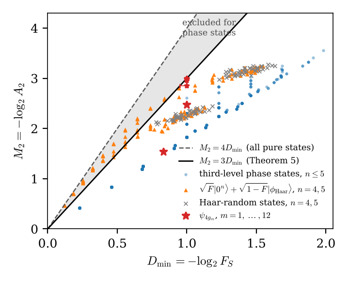
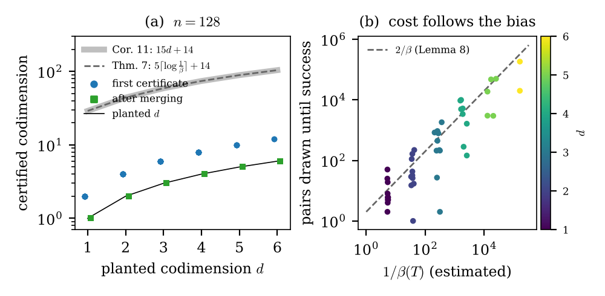

# Peaks reveal structure

Paper and code for

> **Peaks reveal structure: a sharp purity–fidelity bound and exact sampling for third-level phase circuits**
> Matteo De Francesco, University of Geneva
> Manuscript in preparation for *Quantum*. arXiv: *TODO*

This repository contains the LaTeX source of the paper and the Python code for its numerical illustrations. The theorems in the paper are proved analytically. The numerics illustrate them on small and medium instances; they are not part of the proofs.

---

## What the paper is about

Peaked quantum circuits are a proposed route to *verifiable* quantum advantage: a few output strings are unusually likely, so a verifier can test a device by checking how often they appear. The structure that creates the peaks may, however, also make the circuit easy to simulate classically. The paper studies this tension for circuits of the form

$$|\Psi\rangle = C_{\rm out}\, D\, C_{\rm in}\, |0^n\rangle,$$

where $C_{\rm in}$ and $C_{\rm out}$ are arbitrary Clifford circuits and $D$ is a diagonal gate from the third level of the Clifford hierarchy (products of $T$, controlled-$S$ and $CCZ$ gates). Without further promises this family contains cubic IQP circuits, which are believed to be hard to sample.

The key object is the **contraction tensor** $T$: the symmetric trilinear form over $\mathbb{F}_2$ obtained by taking three discrete derivatives of the phase polynomial of $D$. If $T$ vanishes on a subspace of codimension $d$, the state is a coherent sum of $2^d$ stabilizer states.

### Main results

| Result | Statement |
|---|---|
| **Theorem 5** (sharp purity–fidelity bound) | Every state in the family satisfies $A_2 \ge F_S^3$, i.e. $M_2 \le 3 D_{\min}$. The exponent 3 is optimal. For general pure states only $A_2 \ge F_S^4$ holds. |
| **Theorem 7** (certified recovery) | A lower bound $\beta(T) \ge \beta_0$ on the bias of $T$ gives, in expected time $\mathrm{poly}/\beta_0$, a subspace $U$ with $T\vert_U = 0$ and $\mathrm{codim}\, U \le 5\lceil\log(1/\beta_0)\rceil + 14$. The result is checked by linear algebra. |
| **Corollary 11** (planted subspaces) | If $T$ vanishes on *some* subspace of codimension $d$, then $\beta(T) \ge 2^{-3d}$. A planted vanishing subspace of logarithmic codimension cannot stay hidden. |
| **Theorems 13, 14, 16** (exact sampling) | Exact classical sampling of the full output distribution, in polynomial space, from a collision bound ($\mathrm{poly}\cdot\rho^{-5}$), a purity, fidelity or extent bound ($\mathrm{poly}\cdot R^{15}$ for extent $R$), or one concentrated canonical branch. |
| **Theorem 18, Proposition 19** (limits) | The method tolerates logarithmically many $CCZ$ gates outside a commuting family, and it fails for degree-four phases. |

---

## Repository layout

```
.
├── README.md
├── requirements.txt               Python dependencies (numpy, matplotlib)
├── paper/
│   ├── paper.tex                  manuscript (Quantum LaTeX class)
│   ├── quantumarticle.cls         Quantum journal class, v6.1 (LPPL 1.3c)
│   └── figures/                   figures written by the plotting scripts
├── code/
│   ├── magic.py                   exact stabilizer purity A2 and fidelity F_S (n <= 5)
│   ├── gf2.py                     linear algebra over F_2
│   ├── recovery.py                planted instances and the recovery algorithm
│   ├── exp_purity.py              Experiment 1: M2 versus D_min
│   ├── plot_purity.py             Figure 1
│   ├── exp_recovery.py            Experiment 2: recovery of planted subspaces
│   ├── plot_recovery.py           Figure 2
│   └── run_all.sh                 runs everything in order
└── results/
    └── reference/                 outputs of the reference run (see below)
```

---

## Building the paper

You need a TeX distribution with the `lmodern` (or `cm-super`) fonts, which the Quantum class requires.

```bash
cd paper
latexmk -pdf paper.tex        # or run: pdflatex paper.tex   twice
```

Overleaf works as well: upload `paper.tex` and `quantumarticle.cls` to the same project.

The figures in `paper/figures/` are not yet included in `paper.tex`.

---

## Reproducing the numerics

### Setup

```bash
python -m venv .venv && source .venv/bin/activate     # optional
pip install -r requirements.txt
```

Python 3.9 or later is required. All commands below are run from the repository root.

### Quick look: plot the reference run

The folder `results/reference/` contains the outputs of our run. To redraw the figures from it without any computation:

```bash
python code/plot_purity.py   results/reference
python code/plot_recovery.py results/reference
```

The reference run has no timing data, so Figure 2 then has two panels instead of three.

### Full run

```bash
bash code/run_all.sh
```

or step by step:

| Step | Command | Time on one CPU core | Output |
|---|---|---|---|
| Experiment 1 | `python code/exp_purity.py` | about 1 min | `results/purity_records.json` |
| Figure 1 | `python code/plot_purity.py` | seconds | `paper/figures/fig_purity_fidelity.{pdf,png}` |
| Experiment 2a | `python code/exp_recovery.py codim` | about 20–40 min | `results/recovery_codim.jsonl` |
| Experiment 2b | `python code/exp_recovery.py time` | estimated 10–30 min | `results/recovery_time.jsonl` |
| Figure 2 | `python code/plot_recovery.py` | seconds | `paper/figures/fig_recovery.{pdf,png}` |

All random seeds are fixed. Experiment 1 reproduces `results/reference/purity_records.json` (on other machines, up to floating-point rounding). The run times are approximate and depend on the BLAS library. Experiment 2b was not run to completion for the reference data, so its time is an estimate. Each finished instance of Experiment 2 is written to its `.jsonl` file at once, so an interrupted run keeps its results; for long runs, use for example `nohup python code/exp_recovery.py codim > codim.log &`.

---

## Experiment 1: purity versus fidelity (Theorem 5)

**What it does.** For small states ($n \le 5$) it computes $M_2 = -\log_2 A_2$ from all Pauli expectation values and $D_{\min} = -\log_2 F_S$ by enumerating *all* stabilizer states (2,423,520 for $n = 5$). It compares:

* random third-level phase states (random products of $T$, $T^\dagger$, $S$, $CS$, $CS^\dagger$, $CZ$, $CCZ$ on $|+^n\rangle$, and random hypergraph states);
* the sharpness states $\psi_{4g_m}$ from the proof of Theorem 5;
* general states $\sqrt{F}\,|0^n\rangle + \sqrt{1-F}\,|\phi\rangle$ with $\phi$ Haar-random, and Haar-random states.

**What you should see.**

* All 1,043 non-stabilizer phase states satisfy $M_2 \le 3D_{\min}$; the largest ratio is 2.61. The script prints `min A2 - F^3 = 0.039`; a positive value means no violation.
* The general "stabilizer + Haar" states reach $M_2/D_{\min} = 3.94$ at $n = 5$, close to the general limit 4 (Remark 6).
* As a correctness check, the fidelity of $CCZ|{+}{+}{+}\rangle$ ($m = 1$) is the known value $9/16$; for $m = 2$ it is $1/2$.

In the figure, blue points stay below the black line $M_2 = 3D_{\min}$, orange triangles enter the grey band up to the dashed line $M_2 = 4D_{\min}$, and the red stars approach the point $(1, 3)$.



---

## Experiment 2: recovering planted subspaces (Theorem 7, Corollary 11)

**What it does.** It builds random contraction tensors on $n = 128$ qubits that vanish on a hidden subspace of codimension $d = 1,\dots,6$: in hidden coordinates, every entry $T_{ijk}$ with $\min(i,j,k) \le d$ is a random bit, and a random invertible change of basis hides the coordinates. It then runs the algorithm of Theorem 7 with the a priori bound $\beta_0 = 2^{-3d}$ of Corollary 11.

* The algorithm sees **only the tensor $T$**. The planted subspace is used only to generate the instance and, afterwards, to estimate $\beta(T)$ for the plot.
* "After merging" is a heuristic that the theorems do not cover: two certified subspaces are combined whenever $T$ still vanishes on their sum, which is again checked by linear algebra.
* The `time` mode measures the recovery time for $n = 64, \dots, 256$ and $d = 2, 3$.

**What you should see** (reference run, $n = 128$):

| $d$ | instances | first certificate | after merging | $\log_2 \beta(T)$ (estimated) | worst-case bound $15d+14$ |
|---|---|---|---|---|---|
| 1 | 10 | 2 | 1 | −2.5 to −2.4 | 29 |
| 2 | 10 | 4 | 2 | −5.4 to −5.1 | 44 |
| 3 | 10 | 6 | 3 | −8.5 to −7.7 | 59 |
| 4 | 8 | 8 | 4 | −11.3 to −10.6 | 74 |
| 5 | 5 | 10 | 5 | −14.6 to −13.6 | 89 |
| 6 | 2 | 12 | 6 | −17.3 | 104 |

So the first certificate always has codimension exactly $2d$, merging always reaches the planted value $d$, and every certificate lies inside the planted subspace. The bias is about $1.6 \cdot 2^{-3d}$, so the bound of Corollary 11 is almost tight on these instances, and the number of drawn pairs grows like $1/\beta$. The reference run has only two of the three planned instances for $d = 6$; a full run completes it.



---

## Limitations of the numerics

* $A_2$ and the stabilizer overlaps are computed in double precision. Binary ranks and tensors are exact.
* Exact enumeration of stabilizer states is limited to $n \le 5$; $n = 6$ already has about 315 million stabilizer states.
* The planted instances are random. They illustrate the regime of logarithmic codimension and say nothing about planted subspaces of linear codimension.
* Run times are those of a straightforward NumPy implementation and are not optimized.

---

## How to cite

```bibtex
@misc{DeFrancesco2026peaks,
  author = {De Francesco, Matteo},
  title  = {Peaks reveal structure: a sharp purity--fidelity bound and exact
            sampling for third-level phase circuits},
  year   = {2026},
  note   = {arXiv:TODO}
}
```

## License

*TODO: choose a license.* The file `paper/quantumarticle.cls` is distributed by the Quantum journal under the LaTeX Project Public License 1.3c.

## Contact

Matteo De Francesco — <https://matteodefra.github.io/>
